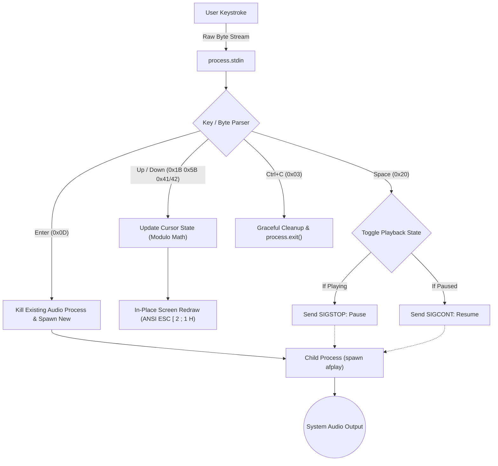

# Terminal Internals & Interactive CLI Music Player

An interactive terminal application and systems-programming experiment suite built in **Node.js**. This project explores low-level terminal I/O, OS line discipline, POSIX signals, ANSI escape sequences, byte streams, and child process orchestration without external third-party dependencies.

---

## 📑 Table of Contents

- [Overview](#overview)
- [Architecture & Data Flow](#architecture--data-flow)
- [Core Concepts Explored](#core-concepts-explored)
  - [1. Terminal Line Discipline (Cooked vs. Raw Mode)](#1-terminal-line-discipline-cooked-vs-raw-mode)
  - [2. Multi-Byte ANSI Escape Sequences](#2-multi-byte-ansi-escape-sequences)
  - [3. In-Place Terminal Redrawing](#3-in-place-terminal-redrawing)
  - [4. Process Lifecycle & POSIX Signals](#4-process-lifecycle--posix-signals)
  - [5. File System Realities (Inodes & Extensions)](#5-file-system-realities-inodes--extensions)
- [Repository Structure](#repository-structure)
- [Prerequisites](#prerequisites)
- [How to Run](#how-to-run)
  - [1. Interactive Music Player](#1-interactive-music-player)
  - [2. Keycode & Buffer Detector](#2-keycode--buffer-detector)
  - [3. Arrow Key Parser](#3-arrow-key-parser)
- [Controls](#controls)
- [Technical Insights & Common Pitfalls](#technical-insights--common-pitfalls)
- [Known Limitations & Future Roadmap](#known-limitations--future-roadmap)

---

## Overview

Unlike standard command-line tools that wait for an `Enter` keystroke and append text continuously, this application creates a responsive, non-scrolling terminal UI with real-time keyboard navigation. It demonstrates how modern scripting runtimes like Node.js interact directly with UNIX kernel primitives (`termios`, `stty`, and signals) to build full-screen CLI experiences.

---

## Architecture & Data Flow



```text
┌────────────────────────────────────────────────────────────────────────────────────────┐
│                                ARCHITECTURE & DATA FLOW                                │
└────────────────────────────────────────────────────────────────────────────────────────┘

    [ User Keyboard ]
           │
           ▼  (Raw Byte Stream: unbuffered, no echo)
    [ process.stdin (Raw Mode) ]
           │
           ▼
    ┌───────────────────────┐
    │   Key / Byte Parser   │
    └───────────────────────┘
       │           │            │                    │
       │ (Arrows)  │ (Enter)    │ (Space)            │ (Ctrl+C: 0x03)
       │ 0x1B..    │ 0x0D       │ 0x20               │
       ▼           ▼            ▼                    ▼
   [ Cursor ]  [ Play Song ]  [ Toggle Pause ]  [ process.exit() ]
   [ Modulo ]      │            │
       │           │            ├─► SIGSTOP (Freeze)
       ▼           │            └─► SIGCONT (Resume)
   [ Redraw UI ]   ▼                    │
   (\x1B[2;1H) [ Child Process: afplay ]◄┘
                   │
                   ▼
         (( System Audio Output ))
```

---

## Core Concepts Explored

### 1. Terminal Line Discipline (Cooked vs. Raw Mode)
* **Canonical / Cooked Mode (Default):** The OS kernel buffers user keystrokes line-by-line until `Enter` is pressed. Key characters are automatically echoed to stdout, and shortcuts like `Ctrl+C` generate an OS `SIGINT`.
* **Raw Mode (`process.stdin.setRawMode(true)`):** Bypasses OS line discipline (`stty raw`). Keystrokes are delivered instantly chunk-by-chunk without echoing. 
* *Notice:* Because the OS no longer catches `Ctrl+C`, the application intercepts byte `0x03` manually and invokes `process.exit()`.

### 2. Multi-Byte ANSI Escape Sequences
Normal alphanumeric characters produce a single ASCII byte (e.g., Space = `0x20` / `32`). Directional navigation keys, however, emit a 3-byte escape sequence:

| Key | Hex Sequence | Decimal Representation | Meaning |
| :--- | :--- | :--- | :--- |
| **Up Arrow** | `0x1B 0x5B 0x41` | `27, 91, 65` | `ESC [ A` |
| **Down Arrow** | `0x1B 0x5B 0x42` | `27, 91, 66` | `ESC [ B` |
| **Right Arrow** | `0x1B 0x5B 0x43` | `27, 91, 67` | `ESC [ C` |
| **Left Arrow** | `0x1B 0x5B 0x44` | `27, 91, 68` | `ESC [ D` |
| **Enter (Raw)** | `0x0D` | `13` | Carriage Return (`\r`) |
| **Ctrl + C** | `0x03` | `3` | End of Text (ETX) |

### 3. In-Place Terminal Redrawing
Standard `console.log()` calls automatically append `\n`, which continuously pushes output down and scrolls the terminal.
* To render the menu in-place, the player issues the ANSI escape sequence `process.stdout.write('\x1B[2;1H')`, moving the hardware cursor back to **Row 2, Column 1** before repainting the song list.

### 4. Process Lifecycle & POSIX Signals
The Node.js parent process coordinates with the OS audio subsystem via `child_process.spawn()`:
* **Audio Playback:** Spawns `afplay` (macOS native audio command) in a decoupled child process.
* **Pausing (`SIGSTOP`):** Freezes the process at the kernel level; CPU consumption drops to 0% while preserving memory and file descriptors.
* **Resuming (`SIGCONT`):** Unfreezes the suspended process to resume execution.
* **Orphan Prevention:** When selecting a new track or exiting, the active child process is explicitly killed (`afPlayProcess.kill()`), preventing duplicate audio playback or orphaned background processes.

### 5. File System Realities (Inodes & Extensions)
Included experiments demonstrate that:
* **Extensions are just labels:** Interpreters read byte content, not file extensions (e.g., running Python code inside a `.js` file).
* **Inodes are true identities:** Filenames are directory entries (hard links) pointing to an underlying disk Inode. Deleting a file (`rm`) merely unlinks a pointer; the data remains until all links are removed.
* **Shell Tokenization:** Filenames containing spaces require proper quoting, and files named like flags (e.g., `-rf`) require `--` delimiters so the shell does not confuse filenames with command flags.

---

## Repository Structure

```text
.
├── README.md                      # Comprehensive project documentation
├── keycode-detector.js            # Raw mode & buffer inspection test script
├── raw_io.js                      # Multi-byte ANSI escape parser for arrow keys
├── py_code.js                     # Cross-interpreter byte execution experiment
├── js_code.py                     # File extension independence experiment
├── -rf                            # Flag lookalike shell tokenization experiment
└── Music Player/
    ├── player.js                  # Main interactive CLI music player
    ├── submission.md              # Technical assignment writeup & architecture
    └── songs/                     # MP3 audio library directory
        ├── with_you.mp3
        └── Dhurandhar Song Baloch...mp3
```

---

## Prerequisites

- **Operating System:** macOS (utilizes built-in `/usr/bin/afplay`)
- **Runtime:** [Node.js](https://nodejs.org/) (v16.0.0 or higher recommended)
- **Terminal:** Interactive TTY terminal emulator (Terminal, iTerm2, Kitty, Alacritty, or VS Code integrated terminal)

---

## How to Run

### 1. Interactive Music Player
Navigate to the `Music Player` folder and launch the application:

```bash
cd "Music Player"
node player.js
```

Add any standard `.mp3` audio files into the `Music Player/songs` directory to include them in the player's tracklist.

### 2. Keycode & Buffer Detector
Inspect raw keyboard byte sequences and verify how Node.js buffers input:

```bash
node keycode-detector.js
```

### 3. Arrow Key Parser
Demonstrates direct parsing of 3-byte escape sequences (`data[2]` matching):

```bash
node raw_io.js
```

---

## Controls

| Key | Byte / Code | Action |
| :--- | :--- | :--- |
| **Up Arrow** (`↑`) | `0x1B 0x5B 0x41` | Navigate to previous song (wraps around to bottom) |
| **Down Arrow** (`↓`) | `0x1B 0x5B 0x42` | Navigate to next song (wraps around to top) |
| **Enter** | `0x0D` (CR) | Play highlighted track (kills active player and spawns new) |
| **Space** | `0x20` | Toggle Pause (`SIGSTOP`) and Resume (`SIGCONT`) |
| **Ctrl + C** | `0x03` (ETX) | Cleanly terminate application and exit raw mode |

---

## Technical Insights & Common Pitfalls

### Buffer Inspection vs. String Conversion
When debugging raw byte input in Node.js, avoid template literals:
```javascript
// ❌ WRONG: Converts buffer to string, mangling non-printable escape bytes
console.log(`Input received: ${data}`);

// ✅ CORRECT: Preserves and prints raw hex byte representation (<Buffer 1b 5b 41>)
console.log("Input received:", data);
```

### Negative Modulo in JavaScript
Array indices must stay within `[0, allSongs.length - 1]`. Because JavaScript's `%` operator calculates the remainder rather than mathematical modulo (`-1 % 5 === -1`), wrapping backwards requires adding array length:
```javascript
// Wrap backwards safely:
cursor = (cursor - 1 + allSongs.length) % allSongs.length;

// Wrap forwards:
cursor = (cursor + 1) % allSongs.length;
```

### Audio Device Clock vs. SIGSTOP (The afplay Glitch)
`afplay` is a simple fire-and-forget CLI player without an Inter-Process Communication (IPC) interface. When frozen using `SIGSTOP`, the hardware audio clock keeps running. Upon unfreezing via `SIGCONT`, an audio buffer underrun occurs, causing playback to skip forward instead of resuming smoothly.

---

## Known Limitations & Future Roadmap

- [ ] **VLC Remote Control (RC) Engine:** Transition from `afplay` to `vlc --intf rc --play-and-exit` via `stdio: 'pipe'` to enable true programmatic pause, seek, and position reporting.
- [ ] **Single-Line Progress Bar:** Implement duration parsing via `afinfo` or audio metadata, rendered using `\r` (Carriage Return) and character bars (`'█'.repeat(filled) + '░'.repeat(empty)`).
- [ ] **ANSI Line Erasure:** Integrate `\x1B[K` (clear to end of line) or `\x1B[2J` to avoid visual artifacts when redrawing titles of variable character lengths.
- [ ] **Cross-Platform Audio:** Support Linux and Windows audio playback engines (`ffplay` / `mpv`).
